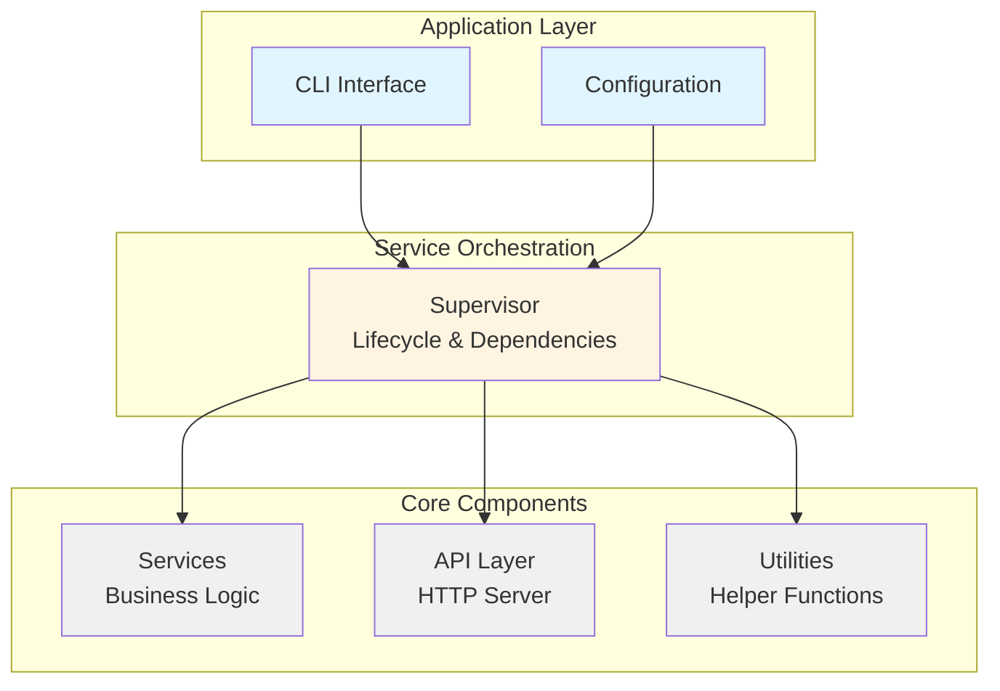
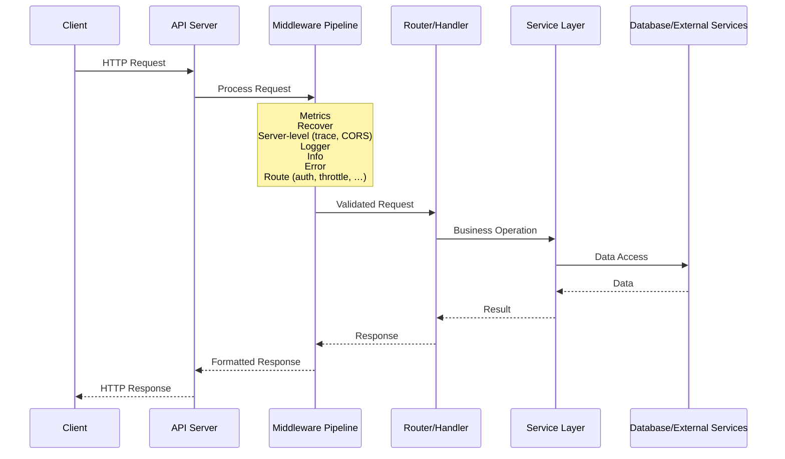

# Framingo

[](LICENSE)
[](https://go.dev/)

**Framingo** is a modular, service-oriented Go framework for building production-ready HTTP API applications. It provides service lifecycle management, dependency resolution, a declarative HTTP router, database integration, pub/sub messaging, and health monitoring — all wired together by a supervisor that handles graceful startup, shutdown, and automatic restart.

## Features

- **Service-Oriented Architecture** — Compose applications from small services with automatic dependency resolution via topological sort

- **Supervisor Lifecycle** — Centralized orchestration with init, start, stop, and per-service runtime restart

- **Health Monitoring** — Kubernetes-style liveness/readiness probes with automatic restart on liveness failure, and an init that can wait for its dependencies to become ready

- **HTTP API Server** — Echo-based server with declarative YAML routing, a middleware pipeline with per-route config and switches, a server-level slot for request-wide middlewares (CORS, tracing), TLS, per-listener HTTP metrics, request validation answered as a 400, and WebSocket support

- **Database Integration** — GORM-backed manager for PostgreSQL, MySQL, SQLite, and ClickHouse with connection pooling, migrations, and context-aware transactions

- **Pub/Sub Messaging** — Hierarchical topic dispatch with pluggable Memory, Redis, and Kafka drivers, plus a higher-level message bus that `wsutil` bridges to WebSocket connections

- **Task Planning** — Concurrent task scheduler with priority, retry, and result tracking, plus a plan manager that records every run

- **OpenTelemetry Tracing** — Supervised `TracerProvider` lifecycle with pluggable OTLP/stdout exporters and a built-in server middleware that traces every request, propagates W3C trace context, and never touches the otel globals

- **OpenTelemetry Metrics** — Supervised `MeterProvider` with the same pluggable exporters and a periodic export loop, handed out as an explicit `model.Meter`; the API server records per-listener HTTP metrics through it

- **Instance-Based Configuration** — Viper instance propagated through `context.Context` (no global singletons), re-read by each service's `Init` on every restart; the bundled example re-reads its file on SIGHUP alone

- **Structured Logging** — Zap-based logger with file rotation and per-service scoping

- **Production Ready** — Graceful shutdown and error categorization via `xhanio/errors`, with the bundled example wiring OS signal handling (SIGINT/SIGTERM/SIGHUP/SIGUSR1/SIGUSR2) and pprof on top

## Table of Contents

- [Quick Start](#quick-start)
- [Architecture](#architecture)
- [Core Modules](#core-modules)
- [Building Your First Application](#building-your-first-application)
- [Documentation](#documentation)
- [Starter Template](#starter-template)
- [Key Concepts](#key-concepts)
- [Configuration](#configuration)
- [Production Deployment](#production-deployment)
- [Best Practices](#best-practices)
- [Contributing](#contributing)
- [License](#license)

## Quick Start

### Installation

```bash
go get github.com/xhanio/framingo
```

### Trying It Out

The fastest path to a working server is the template under [example/](example/). Run it first to confirm your toolchain, then fork it — see [Starter Template](#starter-template).

The template builds with [GoPro](https://github.com/xhanio/gopro), which owns a layer framingo has nothing to do with: `project.yaml`, per-environment config generation, Docker images and Kubernetes manifests. **Framingo itself has no build-tool dependency** — the entry points under `example/build/binary/` are ordinary `main` packages, so `go build ./build/binary/exampleapp` works. See [What Is Framingo Here, and What Is GoPro](example/QUICKSTART.md#what-is-framingo-here-and-what-is-gopro) for the split and for the two things GoPro does that you'd otherwise do yourself.

Prerequisites:

- **Go 1.25.8+** — the `example/` module's own `go` directive; the framework module itself needs 1.25 (the OpenTelemetry SDK's floor). On an older toolchain the default `GOTOOLCHAIN=auto` fetches it for you, but `GOTOOLCHAIN=local` will hard-fail
- **A C toolchain**, since the example blank-imports the SQLite driver and therefore builds with `CGO_ENABLED=1`
- **PostgreSQL on `localhost:5432`** with database `framingo_example` (user `framingo`, password `framingo_dev`) — that's what the local config points at. A compose template ships at [example/env/local/docker-compose/](example/env/local/docker-compose/); `gopro generate docker-compose -e local` renders it into `dist/local`, where `docker compose up postgres` starts just the database, or the whole stack, daemon included (see [example/QUICKSTART.md](example/QUICKSTART.md#local-docker-compose))

```bash
go install github.com/xhanio/gopro@latest

cd example
gopro build binary -e local
gopro generate config -e local     # renders dist/, which holds the migrations the config points at

./bin/exampleapp daemon -c env/local/config/exampleapp/config.yaml
```

`dist/` is generated and gitignored, so a fresh clone needs the `generate` step before the first run — without it the database migrations are not found.

In another terminal:

```bash
# Log in first — the helloworld endpoint is protected by authnuser middleware
./bin/examplecli -e http://localhost:8080/api/v1 login     # -e is the API base, prefix included; default admin / admin

./bin/examplecli -e http://localhost:8080/api/v1 helloworld "Hello"
# {"id":1,"message":"Hello","created_at":"...","updated_at":"..."}   (the greeting only goes to the server log)
```

See [example/QUICKSTART.md](example/QUICKSTART.md) for the full walkthrough.

## Architecture

Framingo follows a layered architecture pattern:



### Request Flow



## Core Modules

Framingo is organized into five module categories under `pkg/`:

### Services (`pkg/services/`)

Production-ready service implementations:

- **[supervisor](pkg/services/supervisor/)** — Service lifecycle orchestration
  - Topologically sorts registered services by `Dependencies()`, skipping a nil entry (an optional dependency left out)
  - Calls `Init(ctx)` and `Start(ctx)` in dependency order, `Stop(ctx)` in reverse; a service starts once its `Init` succeeded and its dependencies run, the rest left to the monitor
  - Monitors `Liveness`/`Readiness` probes and auto-restarts services that fail liveness, once `WithMonitorPolicy` gives it an interval (monitoring is off by default)
  - A name stands for one instance: `Register` returns a `Conflict` for another instance under a name already taken (give each its own `WithName`)
  - Per-service runtime control (`InitService`, `StartService`, `StopService`, `RestartService`); a `Reconcilable` dependent is told what a dependency stopped or started alone has become, and puts back what it registered there
  - Whole-graph `Restart(ctx)`, `Stats()` per service, and a `Debuggable.Info` dump
  - Tunable by policy: `WithMonitorPolicy(interval, maxRetries, restartDelay)` for liveness restarts, `WithInitPolicy(maxRetries, delay, maxDelay)` to retry the boot's init turns until dependencies are ready (a later `Init`, a reload's, makes one pass), `WithStartPolicy(timeout)` to bound each `Start`, `WithStopPolicy(timeout)` to bound shutdown

- **[api/server](pkg/services/api/server/)** — HTTP API server
  - Multi-server support: `Add(name, WithEndpoint(...), WithTLS(...), WithMiddlewares(...), WithMiddlewareConfigs(...))`
  - Declarative YAML routing via `api.Router`
  - Middleware pipeline with name-based resolution
  - WebSocket handlers (use method `WS` in router YAML); `Stop` closes their connections and waits for the handlers, as it does for in-flight requests, until its context ends
  - Built-in chain — metrics, recover, logger, info, error — in a fixed order, plain lifecycle functions taking no config; `WithMiddlewares` adds server-level `api.Middleware`s between recover and logger (the framework's `trace`, the example's `cors`), each dormant until the server's middleware configs name it
  - `WithMeter(model.Meter)` feeds the metrics built-in; without it the instruments are noops
  - `c.Validate` failing a `validate` tag returns an `InvalidArgument` error, so the client gets a 400

- **[api/client](pkg/services/api/client/)** — HTTP client with TLS, headers, cookies, body encoding (deflate), and structured error parsing — `NewRequest` builds, `Do` executes an `*http.Request`, `Send` does both in one shot

- **[db](pkg/services/db/)** — Database manager (GORM)
  - Pluggable drivers under [db/drivers/](pkg/services/db/drivers/): PostgreSQL, MySQL, SQLite, ClickHouse — blank-import only the ones your binary needs (a SQLite-only binary drops ~17MB)
  - The SQLite driver uses [mattn/go-sqlite3](https://github.com/mattn/go-sqlite3), a cgo wrapper around the C library, so it needs `CGO_ENABLED=1` and a C toolchain. The other drivers are pure Go.
  - Connection pooling: `WithConnection(maxOpen, maxIdle, maxLifetime, maxIdleTime, execTimeout)` sets the pool's defaults, which `db.connection.*` overrides key by key at every `Init`
  - Migrations via `WithMigration(dir, version)` (`version` 0 = latest; an empty dir leaves the schema alone)
  - GORM plugins via `WithPlugins(...)` — [db/plugins/otelgorm](pkg/services/db/plugins/otelgorm/) traces every statement through a `model.Tracer`
  - Context-aware queries: `FromContext(ctx)` auto-extracts an active transaction
  - `Transaction(ctx, fn, opts...)` wraps `fn` in a TX with rollback-on-error, and nests on a transaction already in `ctx` via a savepoint instead of opening a second one
  - Two contracts: `model.Database` (connections, queries, transactions) is what consumers hold; `model.DatabaseDebugger` (`Cleanup`, `Reload` — truncate, or drop and re-migrate) is only on the `db.Manager` itself, for tests and dev tooling

- **[pubsub](pkg/services/pubsub/)** — Publish-subscribe primitive
  - Hierarchical topic subscriptions, non-self-delivery
  - Pluggable backends under [pubsub/driver/](pkg/services/pubsub/driver/): Memory, Redis, Kafka
  - `Publish(ctx, from, topic, kind, payload)` fans out to every subscriber whose topic is a prefix of `topic`
  - `Subscribe(name, topic)` returns a `<-chan entity.PubsubMessage` — a raw channel, not a handler registration; `Unsubscribe(name, topic)` closes it. Handler-style dispatch lives one layer up, in `messagebus`
  - Per-subscriber queue absorbs bursts; a subscriber that stops draining is handled by
    `driver.WithOnFull(...)` — `DropMessage` (default, counted and logged) or `DropSubscriber`
    (close the channel so the peer reconnects). Drop and eviction counts show up in `Info`

- **[messagebus](pkg/services/messagebus/)** — Higher-level dispatch on top of `pubsub`
  - Single well-known topic with module-centric routing — `Register(module)` picks up `common.MessageHandler` / `common.RawMessageHandler` and skips modules implementing neither
  - Typed (`common.Message`) and raw (`kind`, payload) handlers
  - `NewMessenger(name)` for direct channel access; [`wsutil.Bridge(conn, messenger)`](pkg/utils/wsutil/) bridges one to a WebSocket connection

- **[task](pkg/services/task/)** — Task manager (`model.Task` + `Daemon`)
  - Runs `entity.Task`s by schedule, by `Trigger` or once, in priority then arrival order, within a concurrency limit
  - Retries, requeues on failure, exclusive tasks

- **[plan](pkg/services/plan/)** — Plan manager (`model.Plan` + `Daemon`)
  - Plans with labels, schedules and a source for every run, on a task manager of your own
  - A command plan records each run (`PlanRun`, its log file and output tail) and reports it through a `MessageSender`

- **[tracing](pkg/services/tracing/)** — OpenTelemetry tracing
  - Owns the SDK `TracerProvider`: built from `tracing.*` config keys in `Init` (so restarts re-point or re-sample it), flushed in `Stop`; disabled serves a noop provider, so spans are always safe to start
  - Exporters behind a blank-import registry ([`exporters/`](pkg/services/tracing/exporters/)): `otlpgrpc`, `otlphttp`, `stdout` — binaries link only what they import
  - Explicit `model.Tracer` handle everywhere — the otel globals are never set; the framework-shipped `trace` middleware ([pkg/middlewares/trace/](pkg/middlewares/trace/)) rides the server-level slot and traces every request (W3C context extraction, route-template span names, the framingo `tid` as a `api.trace_id` attribute), activated per server with `trace: true` in the middleware configs

- **[metrics](pkg/services/metrics/)** — OpenTelemetry metrics
  - Owns the SDK `MeterProvider`, fixed for the process lifetime so instruments are created once; `Init` re-reads `metrics.*` (`enabled`, `exporter`, `config`, `interval`) and swaps the exporter, `Stop` flushes it
  - Same blank-import exporter registry ([`exporters/`](pkg/services/metrics/exporters/)): `otlpgrpc`, `otlphttp`, `stdout`
  - Explicit `model.Meter` handle — no otel globals; implements `Liveness` but deliberately not `Readiness`, so a dead collector never gates dependents

### Middlewares (`pkg/middlewares/`)

Framework-shipped `api.Middleware`s:

- **[trace](pkg/middlewares/trace/)** — Server-level request tracing on an explicit `model.Tracer` (see tracing above); `trace.New(tracer)` into `server.WithMiddlewares`, enabled per server with `trace: true`

### Types (`pkg/types/`)

Interface contracts and shared types:

- **[common](pkg/types/common/)** — Service lifecycle and utility interfaces
  - Lifecycle ([`service.go`](pkg/types/common/service.go)): `Service`, `Initializable`, `Daemon`, `Liveness`, `Readiness`, `Debuggable`, `Reconcilable` (with `DependencyState`)
  - Utility ([`common.go`](pkg/types/common/common.go), [`pair.go`](pkg/types/common/pair.go)): `Named`, `Unique`, `Weighted`, `Pair`/`Pairs`
  - Messaging ([`message.go`](pkg/types/common/message.go)): `Message`, `MessageSender`, `RawMessageSender`, `MessageHandler`, `RawMessageHandler`
  - Context keys ([`context.go`](pkg/types/common/context.go)): `_config`, `_logger`, `_db`, `_tx`, `_credential`, `_session`, `_namespace`, `_trace`, `_api_request_info`, `_api_response_info`, `_api_error`

- **[api](pkg/types/api/)** — HTTP types: the two extension interfaces `Router` and `Middleware`, the `MethodAny`/`MethodWS` methods, plus `Endpoint`, `ClientTLS`/`ServerTLS`, `ErrorBody`, `Encoding`, and the `RequestInfo`/`ResponseInfo`/`Stats` records the built-in middlewares stash on the request context. The router.yaml schema itself is private to the server package: routers hand it over as bytes, middlewares receive their config the same way

- **[model](pkg/types/model/)** — Behavioral contracts for framework services: `Supervisor`, `Database`, `DatabaseDebugger`, `Pubsub`, `MessageBus`, `Messenger`, `Task`, `Plan`, `Tracer`, `Meter`

- **[entity](pkg/types/entity/)** — Data carriers (POJOs) taken or emitted by framework services: `SupervisorStats` and the supervisor policies, `Task`, `TaskStats`, `Plan`, `PlanRun`, `PlanStats`, `PubsubMessage`

- **[orm](pkg/types/orm/)** — Generic ORM base types: `Record[T]`, `Referenced[T]`, `Reference[T]`

- **[info](pkg/types/info/)** — Build metadata (application name/version, product name/model/version, project root/name/path, git tag/branch/commit, build version/type/date/time) injected at link time

### Tools (`pkg/tools/`) and the `framingo` command

The module's root package is a command, versioned with the framework:
`go install github.com/xhanio/framingo@latest`. Its subcommands live in
[pkg/components/cmd/framingo](pkg/components/cmd/framingo/), what they run in
`pkg/tools/`.

- **[verify](pkg/tools/verify/)** — `framingo verify [dir...]`: gofmt, build, vet, the analyzers below, golangci-lint and the tests with `-race` for each module, every step run, one verdict at the end
- **[docs](pkg/tools/docs/)** — `docs.Links` and `docs.Snippets`: a markdown link reaches its file and heading, and a Go snippet marked `<!-- source: path -->` says what that file says; the package's tests run both on this repository, check its version surfaces agree, and run `framingo verify` on an app laid out from the skill's templates
- **[vet](pkg/tools/vet/)** — `framingo vet [packages]`: the framework's analyzers, run through `go vet`, one package per rule — `startctx` (a `Start` that keeps its context), `depslist` (a held service missing from `Dependencies`, or a condition in it), `platformfirst` (an app service's `New` not taking the platform first), `gormfield` (a `*gorm.DB` kept in a struct field outside db), `confinit` (`confutil.FromContext` outside `Init`) and `optionclass` (an option in an `option.go` marked neither construction nor reloadable); `//framingo:ignore <rule> <reason>` opts a line out

### Data Structures (`pkg/structs/`)

- **[buffer](pkg/structs/buffer/)** — Generic object pool and pooled read/write/seek buffer
- **[graph](pkg/structs/graph/)** — Topologically-sortable directed graph (used by the supervisor)
- **[lease](pkg/structs/lease/)** — Time-based lease manager with renewal hooks
- **[queue](pkg/structs/queue/)** — Double-buffered queue with auto-swap intervals
- **[staque](pkg/structs/staque/)** — Hybrid stack/queue with priority and blocking variants
- **[trie](pkg/structs/trie/)** — Prefix tree with fuzzy and prefix search (UTF-8 friendly)

### Utilities (`pkg/utils/`)

| Package | Purpose |
| --- | --- |
| **[certutil](pkg/utils/certutil/)** | X.509 CA/server/client cert generation, CSR signing (`ParseCSR`, `SignCSR`: the requester keeps its key) and TLS config |
| **[cmdutil](pkg/utils/cmdutil/)** | External command execution: `Start`/`Wait`/`Run`, `Terminate`/`Kill` of the process or its process group, output to writers or collected; plus `MergeArgs` for last-wins flag merging. Keeps `exec.Cmd`'s contract — wait once, read the collected output after `Wait` |
| **[cronutil](pkg/utils/cronutil/)** | The cron grammar the task manager schedules with, and `Validate(spec)` to reject a bad schedule up front |
| **[confutil](pkg/utils/confutil/)** | `Config` read-side over a Viper instance, propagated via `context.Context`; getters take format-string keys |
| **[envutil](pkg/utils/envutil/)** | Env-var prefix derivation (`EnvPrefix`) and last-wins env merging (`Merge`) |
| **[osutil](pkg/utils/osutil/)** | Queries about the operating system, no process-wide state: `Timezone` is the system's configured zone as timedatectl reports it |
| **[ioutil](pkg/utils/ioutil/)** | File copy/compress/encrypt with progress tracking, plus `LimitWriter`/`LimitReader` for bounding untrusted streams (the reader fails past its limit rather than truncating) |
| **[job](pkg/utils/job/)** | Job model with state, labels, results, statistics, and signals |
| **[jobs](pkg/utils/jobs/)** | Predefined job functions: `jobs.Command` runs a command in its own process group, stopping it on the job's cancel and `SignalKill` |
| **[job/executor](pkg/utils/job/executor/)** | Executor with retry, timeout, and stop control |
| **[log](pkg/utils/log/)** | Zap-based logger with file rotation, custom levels, per-service scoping, and `NoStdout` to suppress the console core |
| **[maputil](pkg/utils/maputil/)** | Map and set helpers (copy, diff, keys, membership) |
| **[nameutil](pkg/utils/nameutil/)** | Service/router naming (`Name`, `Package`) and the config root a name implies (`ConfigRoot`) |
| **[netutil](pkg/utils/netutil/)** | MAC/CIDR/IP helpers |
| **[otelutil](pkg/utils/otelutil/)** | Plumbing shared by the tracing and metrics services: the exporter `Registry`, the otlp config vocabulary with a strict `Decode`, and HTTP semconv helpers |
| **[pageutil](pkg/utils/pageutil/)** | Pagination wrapper (items, total, params) |
| **[paramutil](pkg/utils/paramutil/)** | Ordered key/value params in several notations (`a=b&c=d`, `a=b c=d`, command lines): parse, render, merge |
| **[pathutil](pkg/utils/pathutil/)** | Path shortening |
| **[plans](pkg/utils/plans/)** | Predefined kinds of plan for the plan manager: `plans.Command` turns a command plan into what each of its runs does |
| **[printutil](pkg/utils/printutil/)** | Console table formatting |
| **[reflectutil](pkg/utils/reflectutil/)** | Type location, byte conversion, field scan/apply |
| **[sliceutil](pkg/utils/sliceutil/)** | Membership, dedupe, diff, copy, change tracking |
| **[strutil](pkg/utils/strutil/)** | Validation, join, clean, random, hex format |
| **[syncutil](pkg/utils/syncutil/)** | `WaitGroup` whose `Wait(ctx)` gives up once the context ends; `Loop`, the goroutine a start runs to take new work, which `Stop` ends and waits for |
| **[testutil](pkg/utils/testutil/)** | Test helpers: `SetupDB` (in-memory SQLite, needs cgo), and `Tracer`/`Meter` doubles with in-memory recorders |
| **[timeutil](pkg/utils/timeutil/)** | Timestamp comparison helpers |
| **[traceutil](pkg/utils/traceutil/)** | `model.Tracer` as plain OpenTelemetry: `Start`/`Fail` for spans, `Follow`/`LiveProvider` for a provider that follows a swapped pipeline |
| **[wsutil](pkg/utils/wsutil/)** | WebSocket helpers: `Bridge` joins a connection to a bus Messenger both ways, with server-side pings tunable via `WithPing`, a session's own messages, frames, inbound and end via `WithFilter`/`WithFrame`/`WithInbound`/`WithDone`; `ReadFirst` reads a handshake's first frame, `PeerGone` telling a peer gone from a refusal; `Close` ends a connection with the status its handler's result calls for, a `CloseWith(status, reason)` or `CloseWithCause(status, reason, cause)` its own |

## Building Your First Application

Start from the example, not from scratch: [example/QUICKSTART.md](example/QUICKSTART.md)
forks it into your own module, renames it, and says what to keep and what to
rip out. It builds, runs and passes `framingo verify` as it stands, so every
step from there is a change you can check.

## Documentation

- **[example/QUICKSTART.md](example/QUICKSTART.md)** — Fork the template, plus build/run with GoPro
- **[example/](example/)** — The starter template: fork it to begin a new service (supervisor, db, pubsub, messagebus, RBAC, CLI client)
- **Framework packages**:
  - **[pkg/services/](pkg/services/)** — supervisor, api server/client, db, pubsub, messagebus, plan, task, tracing, metrics
  - **[pkg/middlewares/](pkg/middlewares/)** — framework-shipped `api.Middleware`s: trace
  - **[pkg/types/](pkg/types/)** — common, api, model, entity, orm, info
  - **[pkg/utils/](pkg/utils/)** — log and the other utility packages listed above
  - **[pkg/structs/](pkg/structs/)** — graph, queue, buffer, trie, lease, staque

View package docs locally:

```bash
go doc github.com/xhanio/framingo/pkg/services/supervisor
go doc github.com/xhanio/framingo/pkg/services/api/server
go doc github.com/xhanio/framingo/pkg/services/messagebus
```

### Claude Code plugin

The same material is packaged as a Claude Code skill so an agent writes
framingo code correctly without being walked through the conventions:

```
/plugin marketplace add https://github.com/xhanio/plugins
/plugin install framingo@xhanio
```

It activates on its own whenever a session touches framingo. See
[`plugins/framingo/README.md`](plugins/framingo/README.md).

## Starter Template

**[example/](example/) is a template project — fork it rather than scaffolding from scratch.** It is a self-contained module wired end to end (supervisor, database + migrations, pub/sub and message bus, tracing and metrics, RBAC, WebSocket stream, CLI client, Docker image, docker compose, Kubernetes manifests), so a new service starts from something that already builds and runs. [example/QUICKSTART.md](example/QUICKSTART.md) has the fork-and-rename recipe and a "keep vs. rip out" table for pruning what you don't need.

It is a real module, not a snippet: its own `go.mod` carries `replace github.com/xhanio/framingo => ../` (annotated to remove when you fork), so `go build ./...` and `go test ./...` inside `example/` run against the framework as it currently stands in this tree rather than a published version.

```
example/
├── pkg/
│   ├── components/
│   │   ├── cmd/
│   │   │   ├── app/                 # daemon CLI (daemon, migrate, version)
│   │   │   └── cli/                 # client CLI (login, logout, helloworld, stream, certutil, version)
│   │   ├── server/example/          # supervisor wiring for the daemon
│   │   └── client/example/          # HTTP client SDK
│   ├── services/
│   │   ├── example/                 # business service (HelloWorld)
│   │   ├── repository/              # one GORM repository behind every types/repo contract; the only orm user
│   │   └── system/                  # auth, user, role, organization, certificate, platform
│   ├── routers/                     # auth, certificate, example, health, messagebus, role, user
│   ├── middlewares/                 # authnagent, authnuser, authz, cors, deflate, feature, throttle
│   ├── types/                       # api, entity, model, orm, repo, message, rbac, preset
│   └── utils/infra/                 # process-wide facts set at startup
├── build/                           # binary entry points (exampleapp, examplecli) and the image Dockerfile
├── env/default/                     # what every env shares: the migrations
├── env/local/                       # local: config, docker compose (postgres + daemon)
├── env/prod/                        # prod: config, Kubernetes manifests + migrate Job
├── dist/                            # generated outputs (configs, migrations, manifests)
└── QUICKSTART.md
```

Build it via GoPro:

```bash
cd example
gopro build binary -e local             # cgo-enabled build
# gopro build image -e local            # docker image

./bin/exampleapp daemon -c env/local/config/exampleapp/config.yaml
```

[`example/project.yaml`](example/project.yaml) defines two environments on top of `env/default`: `local` (docker compose) and `prod` (Kubernetes). Add your own under `env:` there — pointing `config_src`/`config_tgt` at a matching `env/<name>/` tree — before building with `-e <name>`.

### What You Inherit by Forking

- Supervisor-orchestrated lifecycle with topological dependency resolution
- Multiple services: database, pubsub, message bus, tracing, metrics, RBAC, business logic
- HTTP routes with YAML configuration, middlewares (auth, authz failing closed, cors, throttle, deflate, feature flags), health probes, and a WebSocket endpoint via the message-bus router
- Type separation: `api/` (DTOs), `entity/` (domain), `orm/` (database, repository-only), `model/` (service interfaces), `repo/` (data-access contracts)
- Database migrations and pluggable PostgreSQL/MySQL/SQLite/ClickHouse driver subpackages (blank-imported in [example/pkg/components/server/example/service.go](example/pkg/components/server/example/service.go))
- Pub/sub with pluggable Memory/Redis/Kafka backends
- CLI client with credential persistence and certificate helpers
- GoPro-driven build, image, docker compose and Kubernetes manifest generation, with migrations as their own step (`exampleapp migrate`)

## Key Concepts

### Service Lifecycle Interfaces

```go
type Service interface {
    Named                          // Name() string
    Dependencies() []Service       // startup ordering
}

type Initializable interface { Init(ctx context.Context) error }       // setup; called on start AND restart
type Daemon        interface { Start(ctx context.Context) error; Stop(ctx context.Context) error } // Stop waits until ctx ends, then forces
type Liveness      interface { Alive(ctx context.Context) error }      // failure triggers auto-restart (with monitoring on)
type Readiness     interface { Ready(ctx context.Context) error }      // failure reported, never restarted; WithInitPolicy waits on it
type Debuggable    interface { Info(w io.Writer, debug bool) }
type Reconcilable  interface { Reconcile(ctx context.Context, dep Service, state DependencyState) error } // a dependency stopped or started alone: put back what was registered with it
```

Compose only the interfaces a service needs. The supervisor inspects each registered service at runtime to determine which lifecycle hooks to invoke. The supervisor's [skill reference](plugins/framingo/skills/framingo/pkgs/supervisor.md) covers probes, escalation and the init/stop policies in depth.

### Type Separation

```go
// api — wire format with validation
type CreateUserRequest struct {
    Username string `json:"username" validate:"required"`
    Email    string `json:"email"    validate:"required,email"`
}

// entity — pure domain model
type User struct {
    ID       int64
    Username string
    Email    string
}

// orm — persistence model, used only inside the repository
type User struct {
    ID       int64  `gorm:"primaryKey"`
    Username string `gorm:"type:varchar(100);not null"`
    Email    string `gorm:"type:varchar(255);not null"`
}

func (User) TableName() string { return "users" }

// repo — the data-access contract a service consumes; it speaks entity, never orm
type User interface {
    GetUser(ctx context.Context, userID int64) (*entity.User, error)
}
```

Handlers convert `api` ↔ `entity`, the repository converts `orm` → `entity`, and services see only entities and their `repo` contracts — keeping API contracts independent of storage and business logic independent of either. The skill's [design notes](plugins/framingo/skills/framingo/design/data-access.md) give the reasoning.

### Dependency Management

Required dependencies become constructor arguments; optional config flows through functional options. The example's services take its platform — the shared framework handles (database, meter, pubsub, message bus) — first, then their own collaborators, each as the narrowest interface they use. The supervisor uses `Dependencies()` to topologically sort startup and shutdown.

```go
// New returns the interface; newManager returns the concrete type for
// package tests.
func New(platform model.Platform, repo Repository, opts ...Option) Manager {
    return newManager(platform, repo, opts...)
}

func newManager(platform model.Platform, repo Repository, opts ...Option) *manager {
    m := &manager{
        repository: repo,
        mb:         platform.MessageBus(), // a common.RawMessageSender; never nil
    }
    m.applyOptions(opts...)
    m.setDefaults()
    return m
}

func (m *manager) Dependencies() []common.Service {
    // list every dependency held; an optional one left unwired is nil, which the supervisor skips
    return []common.Service{m.repository, m.mb}
}
```

### Router Configuration

```yaml
server: http                    # which server from Add(name, ...) hosts this group; required
prefix: /users
middlewares: [authnuser, authz] # applied to every handler in the group, in this order
handlers:
  - method: GET
    path: /:id
    func: GetUser
    permission: user.read       # metadata; enforced by your own authz middleware
  - method: POST
    path: /
    func: CreateUser
    permission: user.manage
    middlewares:                # handler middlewares run *before* group ones
      - throttle:               # a middleware entry may carry config: the block
          rps: 5.0              # under the name is handed to that middleware,
          burst_size: 10        # raw, when this route is registered
  - method: GET
    path: /status
    func: Status
    poll: true                  # suppress per-request logging for pollers
    middlewares:
      - authz: false            # a boolean switches the group's attachment off for this route
  - method: WS
    path: /events
    func: Events
    permission: user.read
```

Each YAML document is one handler group: a router that needs a second prefix or group middleware chain adds a document after `---` (a user router serving `/users` and `/user` from one file, say), every group resolving its `func:` names against the same `Handlers()`. A route — server, method, path — declared twice, in two groups or two routers, fails registration with `Conflict`, and any mistake in a router's config fails `RegisterRouters` with an error naming the router and the group, so startup fails on it. `method` also accepts `ANY` to match every HTTP verb. `permission` is carried through to the handler's `RequestInfo` (flattened — the parsed schema never leaves the server package) but never enforced by the framework — the example's `authz` and `feature` middlewares read it, and `authz` fails closed: a route it guards that declares no permission is refused, not opened to everyone. A middleware entry is either a bare name or a single-key map: a boolean value is the switch, anything else that middleware's config for this route. Handler entries are collected ahead of the group's, wrap the outside and run first, and a name the handler claims is skipped at group level — so a handler's entry overrides the group's attachment instead of stacking a second run. That ordering is why `authz` belongs at group level after `authnuser`: attached per handler, it would run before the credential exists.

Each router embeds its `router.yaml` and exposes a `Handlers() map[string]any` that maps each `func:` key to a handler implementation. The framework accepts `echo.HandlerFunc` (or `func(echo.Context) error`) for HTTP and `func(echo.Context, *websocket.Conn) error` for WebSocket ([coder/websocket](https://github.com/coder/websocket)) — but the **recommended** pattern is `func(c api.Context) error` (and `func(c api.Context, conn *websocket.Conn) error` for WS), where `api.Context` is a project-defined interface that embeds `echo.Context` and `context.Context`. A small `DiscoverHandlers` helper (see [`example/pkg/types/api/api.go`](example/pkg/types/api/api.go)) reflects over the router's methods and wraps the project-context signature into the echo signature the server expects. This keeps handlers free to evolve (extra binders, session/credential accessors, trace propagation) without rewriting every signature.

The conventional file layout splits each router into `router.go` (factory + `Name`/`Dependencies`/`Config`/`Handlers`) and `handler.go` (the handler method bodies). The standard `Handlers()` implementation just delegates and emits a debug log so route registration is visible at startup:

```go
func (r *router) Handlers() map[string]any {
    handlers := api.DiscoverHandlers(r)
    r.log.Debugf("router %s parsed %d handler(s)", r.Name(), len(handlers))
    return handlers
}
```

### Middleware Pipeline

```
Request → Metrics → Recover → [server-level: trace, cors, …] → Logger → Info → Error → route (auth, throttle, deflate, …) → Handler → Response
```

The server ships five built-ins in a fixed order — metrics, recover, logger, info, error — plain lifecycle functions that take no config. Each position is forced by a dependency: metrics outermost of all, recording into noop instruments unless the listener was given `server.WithMeter`, since it only reads the finished record and must count a recovered panic as the 500 it became; recover next, since everything inside it may panic; server-level middlewares from `WithMiddlewares` after recover but ahead of info, so they run on every request, matched or not — the only place CORS can answer a preflight, which matches no route; logger wrapping info, whose records it reads; error innermost. A server-level middleware stays dormant on a server whose middleware configs carry no entry for its name. The example's `cors` ([example/pkg/middlewares/cors](example/pkg/middlewares/cors/)) is configured that way — `cors: true` for echo's permissive development defaults, a policy block (`allow_origins`/`allow_methods`/`allow_headers`/`allow_credentials`/`max_age`) to tighten, `false` or absent to stay off. Rate limiting stays an app concern too: the example ships it as a route middleware (`example/pkg/middlewares/throttle`).

A middleware implements one method — `Func(enabled bool, config []byte) (func(echo.HandlerFunc) echo.HandlerFunc, error)` — called once per attachment point at registration time, and again on every restart. The switch and the config resolve independently, most-specific-first: the handler entry in router.yaml, else its group entry, else the server's middleware config for that name (`WithMiddlewareConfigs` — a plain name-to-value mapping, typically fed from the app's config.yaml, where a boolean is the switch and anything else the config). A route attachment is enabled unless a `false` says otherwise; config is nil when nothing sets it. Returning `(nil, nil)` declines the attachment. Per-route state lives in the returned closure, and a bad config fails startup, not the first request.

Route middlewares are resolved by name from the set registered with `srv.RegisterMiddlewares(...)` (a name registered twice is a `Conflict`), and the lookup happens while routers are being installed — so always register middlewares before routers, or registration fails with `NotImplemented: middleware <name> not found`. The [api skill reference](plugins/framingo/skills/framingo/pkgs/api.md) covers the pipeline in depth.

### Error Handling

Use [`github.com/xhanio/errors`](https://github.com/xhanio/errors) exclusively. The API server's error handler routes by error category to set the HTTP status; a request failing its `validate` tags comes back from `c.Validate` as `InvalidArgument`, a 400.

```go
return errors.NotFound.Newf("user %s not found", id)

// in the repository: FromContext joins the transaction ctx carries, if any
if err := r.db.FromContext(ctx).Create(u).Error; err != nil {
    return errors.Wrapf(err, "create user %s", u.Name)
}
```

## Configuration

Framingo uses an **instance-based** Viper (not the global singleton). The wiring layer owns it; services see it as `confutil.Config` through `context.Context` and read live config in `Init(ctx)` via `confutil.FromContext(ctx)`. Getters take format-string keys, so a service reads under its own root (`GetInt("%s.connection.max_open", nameutil.ConfigRoot(m.name))`) — the name given to `WithName`, or the package name by default.

Priority (high → low), as viper resolves it:

1. Command-line flags — only if your wiring binds them (`BindPFlags`); the example does not
2. Environment variables — with `AutomaticEnv`, an env prefix from the product name, and a `.` → `_` key replacer, as the example's `newConfig` sets them up ([components-server.md](plugins/framingo/skills/framingo/app/components-server.md))
3. YAML configuration file
4. Default values

```yaml
# config.yaml
log:
  level: -1               # -1=Debug, 0=Info, 1=Warn, 2=Error
  file: /var/log/app.log
  rotation:
    max_size: 100         # MB
    max_backups: 3
    max_age: 7            # days

db:
  type: postgres          # postgres | mysql | sqlite | clickhouse
                          # sqlite requires CGO_ENABLED=1; the others are pure Go
  source:
    host: localhost
    port: 5432
    user: app
    password: secret
    dbname: app
  migration:
    dir: ./migrations
    version: 0            # 0 = latest
  connection:             # re-read by db.Manager.Init on every init/restart
    max_open: 10
    max_idle: 5
    max_lifetime: 1h
    max_idle_time: 30m
    exec_timeout: 30s

tracing:                  # re-read by the tracing service's Init
  enabled: true
  exporter: stdout        # otlpgrpc | otlphttp | stdout (blank-import the exporter)
  sample_ratio: 1.0
  # config: { endpoint: localhost:4317, insecure: true }   # exporter-specific

metrics:                  # re-read by the metrics service's Init
  enabled: true
  exporter: stdout
  interval: 60s

api:
  http:
    host: 0.0.0.0
    port: 8080
    prefix: /api/v1
    middlewares:            # per-middleware switches and default configs, by name
      trace: true           # the framework's trace middleware, as the example wires it
      cors: true            # the example's server-level cors middleware
      throttle:             # the example's throttle middleware
        rps: 100.0
        burst_size: 200

pprof:
  port: 6060              # optional
```

Apart from `db.connection.*`, `tracing.*` and `metrics.*` — which those services' `Init` reads straight from the context `Config` under the instance's root (`db`, `tracing`, `metrics`, or its `WithName`), so a restart picks up changes without a rebuild and a second instance gets its own settings — this layout is a convention, not a schema. Your wiring code maps keys onto constructor options, so rename freely as long as `Init(ctx)` stays the place dynamic values are read.

Override at runtime:

```bash
export FRAMINGO_EXAMPLE_API_HTTP_PORT=9090   # the prefix follows the product name
./bin/exampleapp daemon -c env/local/config/exampleapp/config.yaml
```

## Production Deployment

### Docker

The example builds its image with GoPro — `gopro build image -e <env>` — from
[example/build/image/exampleapp/Dockerfile](example/build/image/exampleapp/Dockerfile),
around a binary `gopro build binary` built with the version and build info
injected. It ships on `ubuntu:22.04`: a binary that blank-imports the SQLite
driver needs `CGO_ENABLED=1`, and the glibc-linked result would not run on
Alpine, so build and ship on the same libc.

### Kubernetes

The example deploys its `prod` environment to Kubernetes from GoPro templates at [example/env/prod/kubernetes/exampleapp/](example/env/prod/kubernetes/exampleapp/) — `env/` is source, `dist/` is output; `gopro generate kubernetes -e prod` renders them, after `gopro generate config -e prod`, since the ConfigMap carries the rendered `env/prod/config/exampleapp/config.yaml` verbatim. The probes hit `/healthz` and `/readyz` on the health listener (`api.health`, port 8081); the pod's environment variables carry the binary's product prefix (`GetEnvKey`), and the database credentials come from a gitignored `secret.env` at generate time. Migrations run once per release in a Job (`exampleapp migrate`, the release's own image), never in the replicas — see [example/QUICKSTART.md](example/QUICKSTART.md#prod-kubernetes). Locally the example runs under docker compose instead.

### Systemd

```ini
[Unit]
Description=My Framingo App

[Service]
ExecStart=/usr/local/bin/myapp daemon -c /etc/myapp/config.yaml
Restart=on-failure
# the SIGTERM to the daemon alone: a plan's commands are its to stop (pkgs/plan.md)
KillMode=mixed

[Install]
WantedBy=multi-user.target
```

## Best Practices

1. **Architecture & Types**
   - Separate `api/`, `entity/`, `orm/`; handlers convert `api` ↔ `entity`, repositories convert `orm` → `entity`, and services stay entity-only, holding their data access as `repo` contracts
   - Pass required dependencies as constructor arguments, optional config as `Option`s
   - Keep business logic independent of HTTP and persistence

2. **Service Design**
   - One `Manager` interface per service in a dedicated package
   - Use an **unexported struct** and **exported interface + factory** — strict convention throughout the framework
   - Declare dependencies explicitly via `Dependencies()`; the supervisor handles ordering
   - Read dynamic config in `Init(ctx)` via `confutil.FromContext(ctx)` under the service's config root, so restarts pick it up and a second instance reads its own keys

3. **Error Handling**
   - Always use `github.com/xhanio/errors` — never `fmt.Errorf` or stdlib `errors`
   - Always wrap with `errors.Wrap`/`errors.Wrapf` instead of returning raw `err`
   - Pick the category (`NotFound`, `BadRequest`, `Internal`, …) that should map to the HTTP status

4. **Configuration**
   - Use YAML for hierarchy; env vars for secrets and per-environment overrides
   - Never reach for `viper.GetXxx` globals; take the instance from context

5. **Testing**
   - Fake collaborators through the narrow interface the service holds — a `model.*` peer, a `repo.*` contract — never its `Manager`
   - Use `testutil` to spin up an isolated DB for integration tests, and its `Tracer`/`Meter` doubles to assert spans and metrics
   - Test ORM ↔ entity conversions explicitly

6. **Performance**
   - Tune `db.connection.*` for your workload
   - Apply throttling per router group or per handler in `router.yaml` (see `example/pkg/middlewares/throttle`)
   - Enable pprof during incidents (`pprof.port`)

## Contributing

Contributions are welcome.

1. Fork the repository
2. Create your feature branch (`git checkout -b feature/amazing-feature`)
3. Commit your changes (`git commit -m 'Add amazing feature'`)
4. Push to the branch (`git push origin feature/amazing-feature`)
5. Open a Pull Request

## License

MIT License — see [LICENSE](LICENSE).

## Resources & Support

- **[example/QUICKSTART.md](example/QUICKSTART.md)** — fork the template, build & run
- **[example/](example/)** — the starter template to fork
- **[Issues](https://github.com/xhanio/framingo/issues)** — bug reports and feature requests
- **[Discussions](https://github.com/xhanio/framingo/discussions)** — questions and community

## Acknowledgments

Built with:

- [Echo](https://echo.labstack.com/) — HTTP framework
- [Cobra](https://github.com/spf13/cobra) — CLI framework
- [Viper](https://github.com/spf13/viper) — configuration management
- [GORM](https://gorm.io/) — ORM
- [zap](https://github.com/uber-go/zap) — structured logging
- [xhanio/errors](https://github.com/xhanio/errors) — categorized error handling

---

**Start building with Framingo today!**
